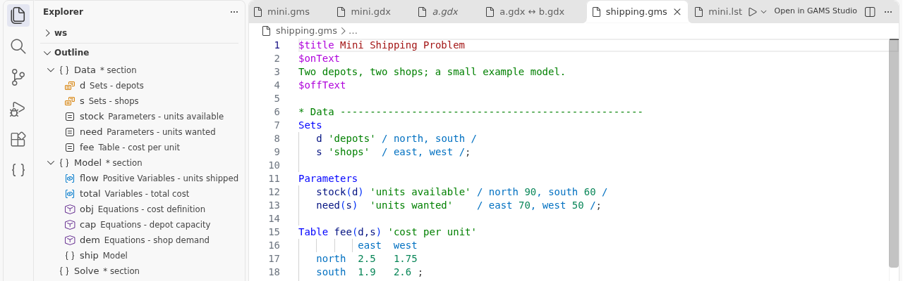
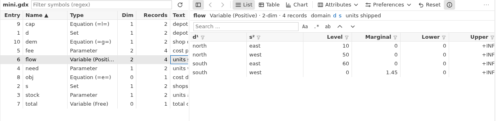

# GAMS for VS Code

Edit, run, debug and inspect GAMS models in Visual Studio Code. Includes a GDX viewer, an outline, help on `F1` and many features known from GAMS Studio.

> **Unofficial.** This extension is an independent project. It is not made, endorsed or supported by GAMS Development Corp. The GAMS software is not included.

> **Pre-release.** Version 0.3 is a complete rewrite. It is published as a pre-release while it is being tested: on the extension page, click **Switch to Pre-Release Version** to try it. The macOS packages are built and tested automatically but have not been tried with a GAMS installation yet. Please report problems on [GitHub](https://github.com/eunseong-park/vscode-gams/issues).

## Features

**Editing** ([guide](docs/guide/02-editing.md))
- Syntax highlighting, optional GAMS Studio colors, MPSGE blocks.
- Completion, outline with sections, folding, go to definition, find references, hover.
- `F1` opens the GAMS documentation for the word at the cursor.

**Running** ([guide](docs/guide/03-running.md), [debugging](docs/guide/04-debugging-profiling.md))
- Run, compile and stop. Clickable log, errors in the Problems panel, listing outline.
- Main files, optional Studio projects (`.gsp`), VS Code tasks, debugger and profiler.

**Data** ([guide](docs/guide/05-gdx.md))
- GDX viewer with list, table and chart views, filters and search. No GAMS needed.
- Compare GDX files, run GDX Diff, export to CSV and Excel, search all GDX files of a folder.

**More** ([option files, model library](docs/guide/06-option-files-model-library.md), [Connect, NEOS](docs/guide/07-connect-neos.md))
- Solver option files with completion and checks, and the GAMS model library.
- GAMS Connect files with validation, and runs on the NEOS Server.

## Requirements

- VS Code 1.95 or newer. To run models, you also need GAMS and a valid license.
- Editing, the outline and the GDX viewer (view, compare, export, search) work without GAMS.
- The GAMS folder (the "sysdir") is taken from the setting `gams.sysdir`. If it is empty, the extension looks for `gams` on your `PATH`, then for the newest GAMS in `/opt/gams`, `C:\GAMS` or the macOS GAMS folder.

## Installation

Open the Extensions view (`Ctrl+Shift+X`), search for "GAMS" and click **Install**, then **Switch to Pre-Release Version** to get 0.3. Or download a `.vsix` file from the [releases page](https://github.com/eunseong-park/vscode-gams/releases) and choose **Install from VSIX...** in the `...` menu of the Extensions view. Packages exist for Windows (x64), Linux (x64, ARM64) and macOS (Apple Silicon, Intel).

## Getting started

1. Choose **File > Open Folder...** and open the folder with your models.
2. Click a `.gms` file. Set `gams.sysdir` in Settings (`Ctrl+,`) if GAMS is not found.
3. Press `F9` to run the model. Your files are saved first.
4. Read the GAMS Log that opens. `Ctrl+click` an error to jump to the line. Errors are also in the Problems panel (`Ctrl+Shift+M`).
5. Click a `.gdx` file in the Explorer to open it in the GDX viewer. ([Details](docs/guide/01-getting-started.md))

## Keys

| Key | Action |
| --- | --- |
| `F9` / `Shift+F9` | Run / Compile |
| `F10` / `Shift+F10` | Run / Compile with parameters |
| `F5` | Start the debugger (VS Code key) |
| `F1` | Help for the word at the cursor |
| `Ctrl+/` | Comment or uncomment lines (column 1) |
| `Ctrl+K Ctrl+C` / `Ctrl+K Ctrl+U` | Add / remove line comment |
| `Shift+Alt+A` | Block comment (`$onText` / `$offText`) |
| `Ctrl+B` | Jump to the matching bracket |
| `Ctrl+Shift+R` | Insert a new section header |

On macOS use `Cmd` for `Ctrl`. `F9`, `Shift+F9`, `F10` and `Shift+F10` work in GAMS files and are off while you debug.

Some of these keys replace VS Code keys in GAMS files (`F9`, `F10`, `F1`, `Ctrl+/`, `Ctrl+B`, `Ctrl+Shift+R` and others). To get one back: set `gams.help.f1` to false for `F1`, set `gams.editor.studioParentheses` to false for `Ctrl+B`, or remove any key in Keyboard Shortcuts (`Ctrl+K Ctrl+S`). See [Settings and keys](docs/guide/08-settings-and-keys.md).

## Key settings

All settings are listed in [Settings and keys](docs/guide/08-settings-and-keys.md).

| Setting | Meaning |
| --- | --- |
| `gams.sysdir` | Your GAMS folder. Empty means auto-detect. |
| `gams.defaultParameters` | Parameters added to every run, for example `["lo=3"]`. |
| `gams.showLogOnRun` | Open the log when a run starts (default on). |
| `gams.openListingAfterRun` | Open the `.lst` file after a run (default off). |
| `gams.studioColors` | Use GAMS Studio colors, for example `auto` (default `off`). |
| `gams.updateReferencesOnSave` | Keep definitions current by compiling on save (default off, uses a license session). |

## Upgrading from 0.1.x

- Your settings are copied once: `GAMS.executablePath` to `gams.sysdir`, `GAMS.commandLineParameters` to `gams.defaultParameters`, `GAMS.idePath` and `GAMS.ideArguments` to `gams.studio.path` and `gams.studio.arguments`. Old settings stay.
- The run-project settings (`GAMS.runProject`, `GAMS.runBatchPath`, `GAMS.projectLst`, `GAMS.projectGDX`, `GAMS.terminalCwd`) still work. They are deprecated. Main files, projects and tasks replace them.
- `F10` was "show listing" and is now "Run with parameters". `Shift+F9` was "run with GDX" and is now "Compile".
- The license changed from Apache-2.0 to GPL-3.0-or-later. More in the [CHANGELOG](CHANGELOG.md).

## Acknowledgements

- [GAMS Studio](https://github.com/GAMS-dev/studio) by GAMS Development Corp. is the model for many features and for the colors.
- The GDX reader and writer are derived from [GAMS-dev/gdx](https://github.com/GAMS-dev/gdx) (MIT).
- The GAMS Connect schemas are generated from the agent schemas of [GAMS-dev/gamsapi](https://github.com/GAMS-dev/gamsapi) (MIT).
- Licenses of all bundled components: [THIRD_PARTY_NOTICES.md](THIRD_PARTY_NOTICES.md).

## Author

Maintained by [Eunseong Park](https://github.com/eunseong-park). Report problems at [GitHub Issues](https://github.com/eunseong-park/vscode-gams/issues).

## License

GPL-3.0-or-later. See [LICENSE](LICENSE).

GAMS is a trademark of GAMS Development Corp. This extension is community-maintained and is not affiliated with or endorsed by GAMS Development Corp. A separately installed and licensed GAMS is required to run models.
