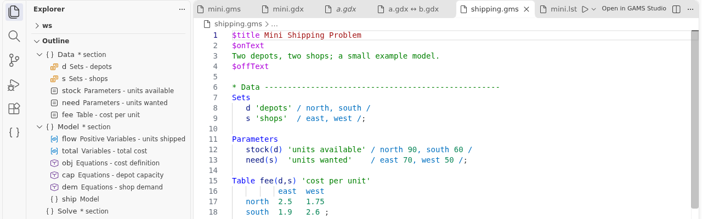

# Getting started

## How do I install the extension?

1. Open VS Code and press `Ctrl+Shift+X` to open the Extensions view.
2. Search for "GAMS" and pick the one published by `eunseong-park`.
3. Click **Install**. While version 0.3 is a pre-release, also click **Switch to Pre-Release Version**.

You can also install a `.vsix` file: in the Extensions view, click the `...` menu and choose **Install from VSIX...**.

VS Code must be version 1.95 or newer.

## What do I need to run models?

You need GAMS installed, with a license that allows your model size. The extension does not include GAMS.

You do not need GAMS for these tasks:

- Editing `.gms` files (highlighting, completion, outline).
- Opening, filtering, comparing and exporting `.gdx` files.

## How do I tell the extension where GAMS is?

Most of the time you do nothing. The extension looks in this order:

1. The setting `gams.sysdir`.
2. A `gams` program found on your `PATH`.
3. The newest GAMS in one of the standard folders:
   - Linux: `/opt/gams/...`
   - Windows: `C:\GAMS\...` and `C:\GAMS\win64\...`
   - macOS: `/Library/Frameworks/GAMS.framework/Versions/.../Resources`

If GAMS is somewhere else, press `Ctrl+,`, search for `gams.sysdir` and enter the folder that contains `gams` (or `gams.exe`). Example: `C:\GAMS\49`. The path of the `gams` program itself works too.

If a run fails with "No GAMS installation found", the message has a button **Open Settings**.

**Several GAMS versions installed?** The extension picks the newest one. To use another version, use the picker:

1. Open a GAMS file. The status bar at the bottom right shows the version in use, for example `GAMS 54.6`. If it says `GAMS: not found` (yellow), no GAMS was found.
2. Click it, or press `Ctrl+Shift+P` and run **GAMS: Select GAMS Installation**.
3. Pick a version from the list. **Automatic (newest found)** goes back to the default, and **Browse...** lets you choose a GAMS folder yourself.
4. Choose **This workspace** (only the folder that is open now) or **All workspaces**. Over SSH or WSL, "All workspaces" is saved on that remote machine.

A choice for one workspace is stored in `.vscode/settings.json` in your project folder:

```json
{
  "gams.sysdir": "C:\\GAMS\\49"
}
```

If `gams.sysdir` is also set at a more specific level, that value wins. The picker tells you and offers to remove it.

**Which version is really used?** Hover over the status bar item to see the full version and folder. Every run also writes `Running: ...` as the first line of the GAMS Log, with the full path of the `gams` program.

**Working over SSH, in WSL or in a container?** The extension runs on the remote machine, so it looks for GAMS there. Set `gams.sysdir` in the **Remote** tab of the Settings editor (`Ctrl+,`), so each machine keeps its own GAMS folder.

## How do I run my first model?

1. Choose **File > Open Folder...** and pick the folder with your models. A folder keeps all your files together.
2. Click a `.gms` file in the Explorer. It opens with colors. The **Outline** view (below the Explorer) shows sets, parameters, variables and equations.
3. Press `F9`. The extension saves your files and starts GAMS.
4. Read the **GAMS Log** that opens beside your file. Errors are links: `Ctrl+click` jumps to the line. Errors are also in the Problems panel (`Ctrl+Shift+M`).
5. If your model writes a `.gdx` file, click it in the Explorer. It opens in the GDX viewer. See [GDX files](05-gdx.md).



## Where do I find things?

- **GAMS icon** in the left Activity Bar: the views Symbols, Projects and GDX Files.
- **Status bar** (bottom left): "GAMS" shows if a run is active. Click it to show the log. A second item shows the main file, if one is set.
- **Run and Compile buttons** at the top right of a `.gms` editor.
- **Command Palette** (`Ctrl+Shift+P`): type "GAMS:" to see all commands.

## Which keys should I know?

| Key | What it does |
| --- | --- |
| `F9` | Run |
| `Shift+F9` | Compile only |
| `F10` | Run with parameters |
| `F1` | Open the help page for the word at the cursor |
| `Ctrl+/` | Comment or uncomment lines |

The full list is in [Settings and keys](08-settings-and-keys.md).

## Does GAMS Studio still work?

Yes. The command **GAMS: Open in GAMS Studio** starts Studio on the current file. It is in the Explorer menu for `.gms`, `.gdx` and `.lst` files. You can set the path to Studio with `gams.studio.path`.

## Next steps

- [Editing GAMS code](02-editing.md)
- [Running models](03-running.md)
