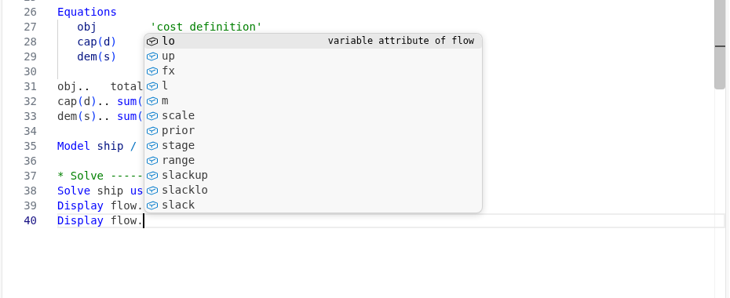
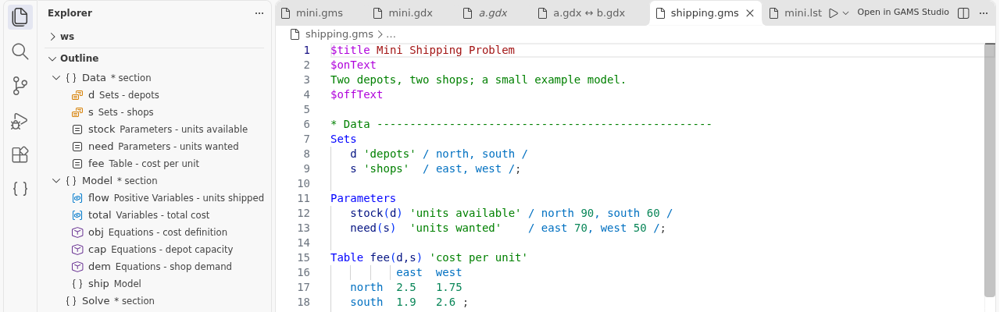
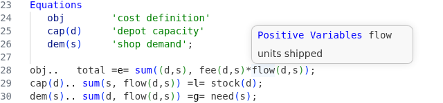

# Editing GAMS code

## What does the extension color?

Files with `.gms`, `.inc` and `.dmp` are GAMS code. Listing files (`.lst`) and option files (`.opt`, `.op2` to `.op9`, `.pf`) have their own modes. Colors follow your VS Code theme.

Do you want the colors of GAMS Studio? Set `gams.studioColors` to `auto`, `light`, `dark`, `distinct-light`, `dracula-dark`, `solarized-light` or `solarized-dark`. `auto` picks light or dark to match your theme. Set it to `off` to go back. The extension writes color rules into your user settings and removes only its own rules again.

## How does completion work?

Suggestions appear while you type. You can open them yourself with `Ctrl+Space`. They also open after `$`, `.` and `%`.

- Type `$` to see dollar control options.
- Type `%` to see compile-time variables.
- Type a dot after a variable, for example `flow.`, to see its attributes (`l`, `m`, `lo`, `up`, ...).
- Type a few letters to see keywords and symbol names.

After you ran the model once, the list also holds symbols from your include files (extra).

## How do I see the structure of my model?

Open the **Outline** view in the Explorer sidebar. It lists sets, parameters, variables, equations and models. Click an entry to jump there. `Ctrl+Shift+O` opens a search box for the same list.

Comment lines like `* Data ------` become sections (extra). Write `**` for a sub-section. The outline shows each section with its symbols below it. You can fold a section with the arrow in the margin. Press `Ctrl+Shift+R` to insert a new section header. Start the name with `**` for a sub-section.

Blocks between `$onText` and `$offText`, data blocks between `/ ... /`, `$ifThen` blocks and brackets can be folded too.

## How do I find where a symbol is defined?

- `F12` (or `Ctrl+click`) goes to the declaration.
- `Shift+F12` lists all places where the symbol is used.
- `Ctrl+T` searches symbols in all files of the model.
- `Ctrl+click` on a file name after `$include` opens that file.

Without a run, these work inside the current file only. Run or compile once (`F9` or `Shift+F9`) to get information across include files. Hover and completion mention when this information may be outdated. If you set `gams.updateReferencesOnSave`, every save compiles the model to keep it current. That starts a GAMS run each time and uses a license session, so it is off by default.

The **Symbols** view in the GAMS sidebar shows the same information as a tree: symbols grouped by type, with every place where they are declared, assigned and used. Use the filter button to search by name. It shows data after a run.

## What does hover show?

Point at a symbol to see its type, domain and description (after a run). Point at a keyword to see a short description, with a link **Open documentation**.

## How do I open the GAMS documentation?

Put the cursor in a word and press `F1`. The help page for that word opens in a panel inside VS Code. It works for dollar control options, keywords and symbols, and for options inside option files. For other words you land in the documentation search. With no word under the cursor you get the start page.

The panel has Home, Back and Forward buttons and a zoom control (`A-`, `100%`, `A+`; also `Ctrl+-`, `Ctrl+0`, `Ctrl++`). **View online** opens the same topic on gams.com.

The pages come from your GAMS installation. Set `gams.help.source` to `online` to open gams.com in your browser instead. If you prefer `F1` for the Command Palette, set `gams.help.f1` to false. The Command Palette stays on `Ctrl+Shift+P`.

## How do I comment code?

A GAMS comment line must start with `*` in column 1. These commands handle this for you. They replace the normal VS Code commands in GAMS files.

- `Ctrl+/` comments or uncomments the selected lines.
- `Ctrl+K Ctrl+C` always comments. `Ctrl+K Ctrl+U` always uncomments.
- `Shift+Alt+A` wraps the lines in `$onText` and `$offText`, or removes them.

On macOS, use `Cmd` instead of `Ctrl` for these keys.

## What do the brackets do?

Matching brackets are highlighted. Red means no partner or a wrong partner. Nested brackets get different colors by depth. Brackets inside comments, quotes and descriptions are ignored.

Press `Ctrl+B` to jump to the matching bracket (and back). VS Code normally uses `Ctrl+B` to hide the sidebar. Set `gams.editor.studioParentheses` to false to get that back. Set `gams.editor.bracketNestingColors` to false to turn off the depth colors.

## Does it support MPSGE?

Yes (extra). Put the model in an `$onText` block whose first text line is `$MODEL:name`. Section words such as `$SECTORS:` and field labels such as `Q:` get their own colors, outline entries, folding, completion and hover text.
