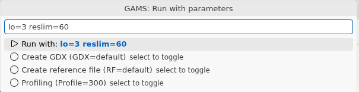
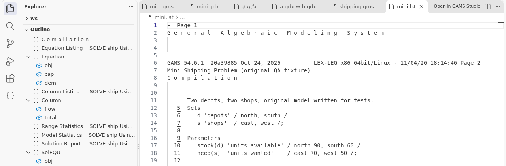

# Running models

You need GAMS installed for everything on this page. See [Getting started](01-getting-started.md).

## How do I run or compile a model?

- Press `F9` (or click the play button at the top right) to run.
- Press `Shift+F9` to compile only. GAMS checks the model but does not solve it.

Before GAMS starts, the extension saves all modified GAMS files. If GAMS is already running, you get a warning. Wait or stop the first run.

## How do I run with my own parameters?

Press `F10` (run) or `Shift+F10` (compile). A box opens.



- Type parameters such as `lo=3 reslim=60 --myflag=1`. Suggestions and checks come from the GAMS option list.
- Press Enter to start.
- Select a toggle to switch it: **Create GDX**, **Create reference file**, **Profiling** (not for compile). The extension remembers your choice.
- The box starts with your last entry. Clear it to see your last 20 entries, and pick one to reuse it.

For parameters on every run, use the setting `gams.defaultParameters`. Example: `["lo=3", "--scenario=base"]`.

## Where do I see the output?

The **GAMS Log** opens beside your file. You can change this with `gams.editor.openLocation` (`beside`, `active` or a group number 1 to 9) and `gams.editor.preserveFocus`. Set `gams.showLogOnRun` to false to keep it closed. The status bar item "GAMS" opens it at any time.

In the log, file names and line numbers are links. `Ctrl+click` opens the file at that line. This works for errors, include files and the listing. Very long logs are cut in the window to the last 50000 lines (`gams.log.maxLines`). The whole log is saved in `<name>.log` in the working folder.

## How do I see my errors?

Compile and execution errors appear in the **Problems** panel (`Ctrl+Shift+M`) and as underlines in the file. Click an entry to jump to the line. The list is cleared at the next run.

## How do I open the listing file?

The listing (`.lst`) is not opened by itself. Click the listing link in the log. Or run **GAMS: Show Listing File** to open `<name>.lst` of the current file. To open it after every run, set `gams.openListingAfterRun` to true.

In a listing, the **Outline** shows sections such as Equation Listing, Solution Report and Display. Line numbers in the compilation part are links back to your `.gms` file.



## How do I stop a run?

Use the Command Palette. These commands appear only while GAMS runs.

- **GAMS: Interrupt** asks GAMS to interrupt, like `Ctrl+C`.
- **GAMS: Stop** interrupts first and waits. If GAMS has not ended after `gams.stopGracePeriod` seconds (default 10), it is killed. Run **Stop** a second time to kill at once. With `0`, Stop kills at once.

The wait matters with a network license. A job that ends by itself frees its license at once. A killed job keeps it reserved for about 5 minutes.

## Which file does GAMS run?

- A `.gms` file that no other file includes runs itself.
- An include file, or a `.gms` file that another file includes, runs the **main file**. If no main file is known, you pick one from a list. The choice is remembered for the workspace.
- To set it yourself, right-click a `.gms` file in the Explorer and choose **GAMS: Set as Main File**, or click "Main: ..." in the status bar.

GAMS runs in the folder of the main file. The listing, log, reference and GDX files are written there.

## Do I need a project?

No. Projects are optional. If your folder has GAMS Studio project files (`*.gsp`), the extension reads them: main file, work folder, parameters and file list. They show in the **Projects** view. A file of a project runs the main file of that project. The extension never creates a `.gsp` file.

## Can I use VS Code tasks?

Yes. Open **Terminal > Run Task** and choose a task with source GAMS. For your own, add this to `.vscode/tasks.json`:

```json
{ "type": "gams", "label": "Run base case", "file": "model.gms", "parameters": ["--scenario=base"] }
```

`file` defaults to the open file. `parameters` are added after `gams.defaultParameters`. Add `"compile": true` to compile only. The output goes to the same log and Problems panel. Chain tasks with `dependsOn`, for example a script before or after GAMS.

## What about the old run-project settings of 0.1.x?

They still work, but are deprecated. With `GAMS.runProject` on and `GAMS.runBatchPath` set, `F9` runs that batch file in a terminal. `GAMS.terminalCwd` sets the working folder. `GAMS.projectLst` and `GAMS.projectGDX` set the files for **GAMS: Show Listing File** and **GAMS: Open Corresponding GDX File**. `GAMS.listingFileLocation` and `GAMS.preserveFocus` are used when the new `gams.editor.*` settings are not set. On first start the extension offers to turn your batch file into a task.
