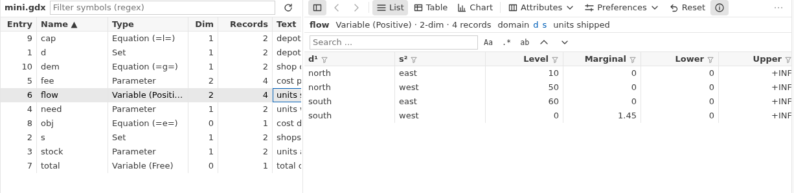
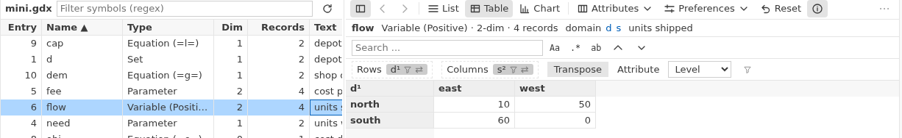
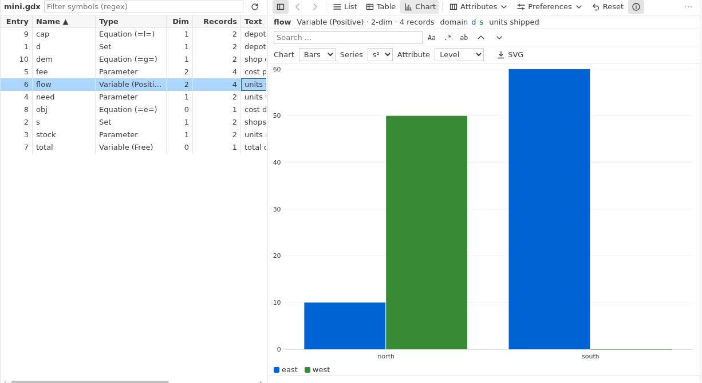
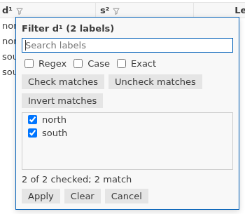
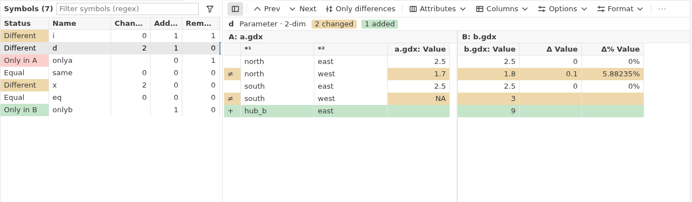

# GDX files

The GDX viewer works without GAMS. You can open, filter, compare and export GDX files on a computer that has no GAMS. Only **GAMS: GDX Diff...** needs GAMS.

## How do I open a GDX file?

Click a `.gdx` file in the Explorer. It opens in the viewer. The left side lists the symbols (sets, parameters, variables, equations). Click a symbol to see its data on the right.

To see all GDX files of your folder, use the **GDX Files** view in the GAMS sidebar. Click a symbol there to open it directly. If you changed the file outside VS Code, the viewer shows a note and reloads it.

## How do I find a symbol?

- Type in **Filter symbols** above the symbol list. It accepts a regular expression.
- Click a column title to sort. Click again to reverse.
- To search all GDX files of your folder, run **GAMS: Find Symbol in GDX Files** (extra). Write words, or `type:par,var`, `dim:2`, `file:*scen*`, `/regex/`.
- To find which symbols use a label, run **GAMS: Find Element in GDX Files** (extra).
- Use the search box in the data area to find labels and values in the current view. `F3` goes to the next match. The buttons `Aa`, `.*` and `ab` mean match case, regular expression and whole cell.

## What are the list, table and chart views?

Use the buttons **List**, **Table** and **Chart** above the data.

- **List**: one row per record. Variables and equations show Level, Marginal, Lower, Upper and Scale.
- **Table**: a pivot table for symbols with two or more dimensions. Drag a dimension between the Rows and Columns boxes, or use **Transpose**. Pick the attribute to show for variables and equations.
- **Chart**: bars or lines. Choose which dimension forms the series. **SVG** saves the chart as an image.

## How do I show only some records?

In the list view, click the filter icon in a column title.

- On a label column, you get a list of labels. Search, tick or untick, then **Apply**. Regex, Case and Exact refine the search.
- On a value column, enter a minimum and maximum. You can hide a range and choose to show UNDF, NA, +INF, -INF and EPS.

**Reset** removes all filters and view settings of the symbol.

## How do I change what the columns show?

- **Attributes** chooses which columns (Level, Marginal, ...) of a variable or equation are visible.
- **Preferences** sets the number format (general, fixed or scientific), precision and a thousands separator.
- `Ctrl+R` fits the column widths.
- `Ctrl+G` goes to a row number.

## How do I follow a domain?

The line above the data shows the domain of the symbol, for example `domain d s`. Click a set name to go to that set. `Alt+Left` and `Alt+Right` move back and forward through the symbols you visited. You can also right-click a column title and choose **Go to domain set**.

## How do I compare two GDX files?

1. In the Explorer, select two `.gdx` files (hold `Ctrl` for the second one).
2. Right-click and choose **GAMS: Compare with...** (extra). With one file selected, you pick the second.

The symbols are listed with a status (only in A, only in B, equal, different) and the number of changed, added and removed rows. Changed cells are colored, added rows green and removed rows red. `F7` and `Shift+F7` jump to the next and previous difference. **Only differences** hides equal rows. **Options** sets tolerances (Eps, RelEps) and what counts as a difference.

To use the GAMS tool gdxdiff instead, right-click and choose **GAMS: GDX Diff...**. You answer a few questions and get a difference file. It opens in a colored view. If you prefer the plain viewer, set `gams.gdxDiff.coloredView` to false.

## How do I export data?

- **Export** in the viewer saves the current view (with filters) as a CSV file. The first row holds the column names.
- **Excel** opens a dialog. Choose symbols, whether filters and hidden attributes apply, and the file names. It writes an `.xlsx` file and a GAMS Connect file that rebuilds it. Tick **Header row with domain names** (extra) to get a frozen header row with domain names in the workbook. It is off by default.
- In the compare view, **CSV** and **Excel** export the differences.
- `Ctrl+C` copies selected cells (comma separated). `Ctrl+Shift+C` copies tab separated.

The viewer only reads. It never changes your GDX file.
