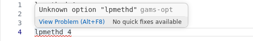

# Option files and model library

## What is an option file?

A solver option file holds settings for one solver. Example: `cplex.opt` holds options for CPLEX. The name before the dot tells the extension which solver the file is for.

The extension knows these file names:

- `.opt` and `.op2` to `.op9`, for example `cplex.opt`, `cplex.op2`.
- `.o10`, `.o11`, ... and `.100`, `.101`, ..., for example `cplex.o10`.
- `.pf`, a parameter file with GAMS command line options.

To make GAMS read the file, switch it on in your model. Example for model `ship`:

```gams
ship.optfile = 1;
```

## How do I edit an option file?

Open the file in VS Code. You get:

- **Completion**: type a few letters or press `Ctrl+Space` to see the options of the solver. After the option name, press space or `=` to see its values.
- **Hover**: point at an option name to read what it does.
- **Checks**: an unknown option or a wrong value is underlined and listed in the Problems panel.
- **Help**: press `F1` on an option name to open the solver manual at that option.
- **Comments**: a line that starts with `*` is a comment.



Completion, hover and checks use the option lists of your GAMS installation. Without GAMS (see [Getting started](01-getting-started.md)) you get none of them.

## How do I get an example model?

Run **GAMS: Open Model Library** from the Command Palette.

1. Pick a library from the list.
2. Pick a model. You can search by name or description.
3. Confirm the target folder. The default is the first folder of your workspace.
4. The extension copies the model and its files to that folder and opens the model file.

If the file already exists, you can open it or replace it. A replaced file is kept as a backup with the ending `.bak1`.

Libraries come from your GAMS installation. You can add your own libraries (`*.glb` files) in a folder and set `gams.userModelLibraryDir` to it. The default is `Documents/GAMS/modellibs` in your home folder.

To use another default target folder, set `gams.modelLibraryTargetDir`. A path with `~` or a relative path is allowed.

## Related settings

| Setting | What it does |
| --- | --- |
| `gams.sysdir` | The GAMS folder used for option lists, libraries and documentation. |
| `gams.userModelLibraryDir` | Folder with your own `*.glb` libraries. |
| `gams.modelLibraryTargetDir` | Default folder where library models are copied. |
